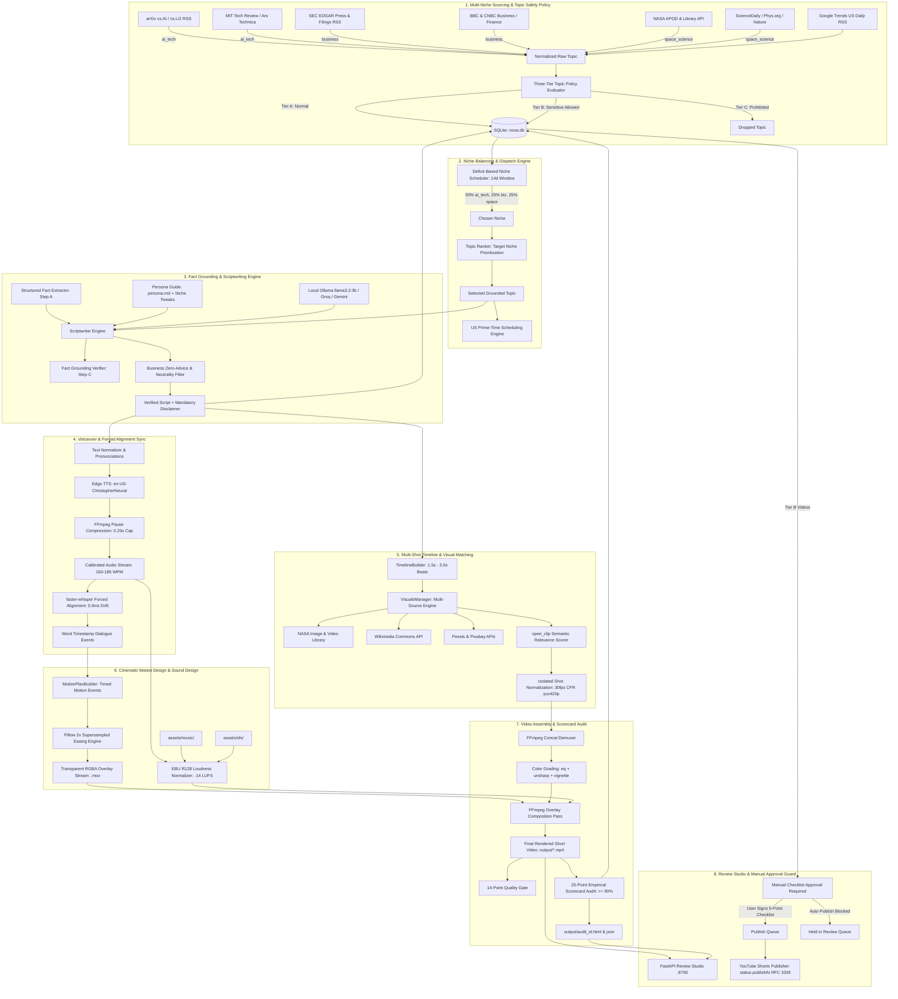

# Nova Autopilot v8.0: Architecture & System Design 📐

> Technical specification, component diagrams, database schema, and motion design engine for Nova Autopilot v8.0.

---

## 1. High-Level Architecture Diagram



---

## 2. End-to-End Linear Execution Lifecycle (14 Stages)

To guarantee that the **8 GB unified memory limit of the Apple M2** is strictly respected, stages execute sequentially with immediate resource deallocation:

### Stage 1: Topic Discovery & Ingestion (`nova.collectors`)
- Collects candidate topics across technical, corporate, scientific, and mainstream RSS and API feeds.
- Batch deduplication uses a pre-fetched set of SHA-256 hashes over normalized tokens.

### Stage 2: Three-Tier Topic Safety Policy & Niche Selection (`nova.topic_safety`, `nova.niches`)
- Classifies topics into **Tier A** (Normal), **Tier B** (Sensitive News Allowed with strict sources & checklist), and **Tier C** (Prohibited Sensationalism).
- Requires 1 primary or 2 independent reputable sources for legal/corporate controversies.
- Deficit-based scheduler balances 50% `ai_tech`, 25% `business`, 25% `space_science`.

### Stage 3: Fact-Grounded Script Generation (`nova.scriptwriter`)
- Step A: Extracts structured factual claims and causal outcomes.
- Step B: Injects niche persona, hook formula (<= 12 words), and verified angle.
- Step C: Checks fact fidelity, duplicate sentences (token Jaccard < 0.80), and neutrality.

### Stage 4: Voiceover & Pacing Calibration (`nova.tts`, `nova.utils.normalizer`)
- Pronunciation expansion via `config/pronunciations.yaml`.
- Narrates via Edge-TTS `en-US-ChristopherNeural`, trims dead pauses, calibrating speaking pace to **160–185 WPM**.

### Stage 5: Forced Alignment & Subtitle Synchronization (`nova.alignment`, `nova.captions`)
- Transcribes audio using `faster-whisper` (`tiny`, CPU int8).
- Aligns word timestamps to script tokens via `difflib.SequenceMatcher`. Enforces median drift <= 60 ms (measured 0.0 ms).
- Pre-renders single transparent RGBA caption stream (`.mov`) using Pillow.

### Stage 6: Multi-Shot Timeline & Visual Matching (`nova.timeline`, `nova.visuals`, `nova.shot_planner`)
- Divides narration into dynamic 1.5s–3.0s visual beats (max 4.0s).
- Searches Pexels, Pixabay, Wikimedia Commons, NASA, Openverse in parallel.
- Evaluates candidates with `open_clip` semantic similarity; unloads model from memory immediately after ranking.
- Normalizes each shot into an isolated 30 fps CFR `yuv420p` MP4 with Ken Burns motion or ping-pong loops.

### Stage 7: Cinematic Motion Design Engine (`nova.motion`)
- Constructs motion plan (`MotionPlanBuilder`) from sentence intents and Whisper word timings.
- Renders supersampled easing overlays:
  - Kinetic key-term pop on high-energy terms.
  - Animated count-up counters on numerical claims (e.g., "$130 Million").
  - Lower-third source attribution tag during opening seconds.
  - Progress bar tracking along the bottom safe zone.
  - MIT open-license RGBA icons (`assets/icons/`).
- Pipes raw RGBA frames directly into an isolated transparent QuickTime stream (`.mov`).

### Stage 8: Audio Mixing & Mastering (`nova.music`, `nova.sfx`)
- Masters narration, mood music, and procedural CC0 sound effects (`assets/sfx/whoosh.wav`, `impact.wav`, etc.).
- Applies dynamic ducking (12% level during speech).
- Masters master audio with two-pass EBU R128 loudnorm targeting **-14 LUFS** and **-1.5 dBTP**.

### Stage 9: Video Assembly & Color Grading (`nova.renderer`)
- Assembles normalized shot MP4s using FFmpeg concat demuxer (`-f concat -safe 0`).
- Composites transparent caption stream and motion design stream in a single overlay pass.
- Applies broadcast color grading (`eq=contrast=1.06:brightness=0.01:saturation=1.08,unsharp=3:3:0.4,vignette=PI/5`).
- Strictly encodes to standard broadcast `yuv420p` (`tv` color range) with faststart web streaming.

### Stage 10: Thumbnail Generation (`nova.thumbnail`)
- Generates high-impact 1080x1920 thumbnail with high-contrast typography and theme palette styling.

### Stage 11: Database Persistence (`nova.pipeline`)
- Persists video metadata, including `tier`, `requires_manual_approval`, `monetization_risk`, `as_of_date`, and `approval_checklist_json`.

### Stage 12: 14-Point Quality Gate (`nova.quality`)
- Hardened validation: duration sync <= 0.1s, 0 decode errors, blackdetect < 0.3s, freezedetect < 1.0s, fallback cards < 10%.

### Stage 13: 25-Point Empirical Scorecard Audit (`nova.audit`)
- Comprehensive audit of audio loudness, true peak, dead silence, WER intelligibility, subtitle drift, cadence, and compliance.
- Generates HTML scorecard report (`output/audit_<id>.html`) and JSON summary.

### Stage 14: Review Dispatch & Tier B Guard (`nova.pipeline`)
- Dispatches video to review queue.
- If video is Tier B or requires manual approval, auto-publishing is strictly blocked until human checklist sign-off.
  2. Pixabay portrait stock video
  3. NASA Image & Video Library (Keyless, public domain)
  4. Wikimedia Commons API (Keyless, Creative Commons CC0/CC-BY)
  5. Openverse CC search (Keyless)
  6. Pexels/Pixabay photos with Ken Burns dynamic motion
- Last resort only: Designed typography cards (never flat color backgrounds).
- Automatically overlays glassmorphic Key Stat badges if a scene highlights a dramatic metric.

### Stage 7: Sound Design & Mixing (`nova.music`)
- Selects mood-matched royalty-free tracks from `assets/music/` based on niche preference:
  - `ai_tech`: `upbeat`
  - `business`: `mystery`
  - `space_science`: `epic`
- Automatically ducks background music to 12% volume during speech.
- Inserts synthesized whoosh and impact sound effects on scene transitions.

### Stage 8: Segment-Based Video Assembly & CFR Normalization (`nova.renderer`, `nova.timeline`)
- **Gapless Timeline Planning (`nova.timeline.TimelineBuilder`)**: Builds a continuous timeline from Whisper word/sentence boundaries covering $0 \rightarrow \text{audio\_duration}$ with 2.0s–3.8s shot pacing (maximum 4.5s per shot). Multiple relevant assets are distributed across sentences so no sentence is left static.
- **Shot Normalization (`nova.visuals.fit_video_shot`, `fit_image_shot`)**: Normalizes each shot independently to 1080x1920, 30fps CFR (`format=yuv420p`), with exact frame count $N = \text{round}(\text{fps} \times \text{duration})$.
  - Short videos are looped forward/reverse (ping-pong) to maintain smooth motion.
  - Still images receive Ken Burns dynamic motion (slow zoom in/out, pan).
- **Single-Pass RGBA Transparent Caption Stream (`nova.captions.create_caption_stream`)**: Renders active-word karaoke subtitles as a single continuous transparent RGBA video stream (`png` codec in `.mov`), replacing hundreds of individual PNG overlay inputs with a single `overlay=0:0` pass.
- **Concat Demuxer Assembly (`nova.renderer.assemble_video`)**: Concatenates normalized shot MP4s using FFmpeg's low-overhead concat demuxer (`-f concat -safe 0`). Blends voice and ducked music with exact audio-video duration sync (`apad=whole_dur` and `-t`), producing streaming-ready MP4s with `-movflags +faststart`.

### Stage 9: Thumbnail Generation (`nova.thumbnails`)
- Extracts a high-action frame and applies a high-contrast title banner and channel branding.

### Stage 10: Video Record Persistence & Prime-Time Scheduling (`nova.schedule_engine`)
- Computes next available slot in US Eastern prime time (`America/New_York`):
  - Lunch peak: 12:00 PM – 1:00 PM Eastern
  - Evening prime: 6:00 PM – 9:00 PM Eastern
- Automatically handles Daylight Saving Time (EDT vs EST) via `zoneinfo`.
- Converts to India Standard Time (`Asia/Kolkata`, +05:30) and stores in `Video` model.

### Stage 11: Rebuilt 14-Point Quality Gate & Dense Frame Inspection (`nova.quality`)
- Runs comprehensive 14-point verification with hard failure modes:
  1. **Duration Integrity**: Video duration == Audio duration ($\le 0.1\text{s}$), frame count == $\text{round}(\text{fps} \times \text{duration})$, full decode with 0 errors.
  2. **Black & Freeze Guard**: `blackdetect` fails on any black $> 0.3\text{s}$; `freezedetect` fails on any freeze $> 1.0\text{s}$.
  3. **Content Coverage**: Samples every 0.5s. Detects dominant colors and spatial variance. Fails if any 1.5s window is mostly empty or if cards exceed 10%.
  4. **Timeline Perceptual Match**: Mid-shot frames matched against 9:16 center-cropped planned assets using perceptual dhash ($\le 0.45$).
  5. **Shot Cadence**: Fails if longest shot $> 4.5\text{s}$.
  6. **Visual Fallback Ratio**: Enforces $\le 10\%$ procedural fallback cards from timeline metadata.
  7. **Subtitle Karaoke Highlight**: Detects active-word yellow highlight pixels in speech safe zones.
  8. **Independent Whisper Forced Alignment Drift**: Runs fresh `faster-whisper` pass on rendered MP4 audio (Median drift $\le 80\text{ms}$, P95 $\le 250\text{ms}$).
  9. **Pacing**: 150–200 WPM.
  10. **Hook Word Count**: $\le 12$ words.
  11. **Fact Grounding Citations**: $\ge 1$ verified fact.
  12. **Original Script**: Verifies no fallback templates used.
  13. **Duration Bounds**: 20s–40s total runtime.
  14. **Business Financial Advice & Banned Phrase Compliance**: Zero financial advice and mandatory disclaimer.
- Extracts dense frames every 0.5s into a high-density contact sheet (`output/dense_contact_sheet_<id>.jpg`).

### Stage 12: Dispatch & Local Publish Queue (`nova.publish_queue`)
- If `publish_mode: review` (default), marks video `pending_review` for Web UI inspection.
- Enqueues video for scheduled local dispatch in `PublishQueue`.
- For background dispatch, a macOS `launchd` plist checks for due items every 10 minutes and prevents sleep during upload via `caffeinate`.

---

## 3. Database Schema Reference (`data/nova.db`)

```sql
CREATE TABLE topics (
    id INTEGER PRIMARY KEY AUTOINCREMENT,
    dedupe_hash VARCHAR(64) UNIQUE NOT NULL,
    title VARCHAR(255) NOT NULL,
    summary TEXT,
    source_name VARCHAR(64) NOT NULL,
    source_url VARCHAR(512),
    region VARCHAR(16) DEFAULT 'US',
    niche VARCHAR(512) DEFAULT 'ai_tech', -- ai_tech, business, space_science
    raw_score FLOAT DEFAULT 0.0,
    final_score FLOAT DEFAULT 0.0,
    status VARCHAR(32) DEFAULT 'pending',
    created_at DATETIME,
    used_at DATETIME
);

CREATE TABLE scripts (
    id INTEGER PRIMARY KEY AUTOINCREMENT,
    topic_id INTEGER REFERENCES topics(id),
    title VARCHAR(255) NOT NULL,
    hook TEXT NOT NULL,
    hook_candidates_json TEXT,         -- 5 rubric candidates
    language VARCHAR(16) DEFAULT 'en',  -- 'en' or 'hinglish'
    niche VARCHAR(50) DEFAULT 'ai_tech',
    scenes_json TEXT NOT NULL,
    cta TEXT,
    hashtags VARCHAR(255),
    description TEXT,
    facts_used_json TEXT,
    model_used VARCHAR(64),
    status VARCHAR(32) DEFAULT 'draft',
    created_at DATETIME
);

CREATE TABLE videos (
    id INTEGER PRIMARY KEY AUTOINCREMENT,
    script_id INTEGER REFERENCES scripts(id),
    video_path VARCHAR(512) NOT NULL,
    thumbnail_path VARCHAR(512),
    subtitle_path VARCHAR(512),
    audio_path VARCHAR(512),
    contact_sheet_path VARCHAR(512),   -- Visual audit grid
    quality_flag VARCHAR(32) DEFAULT 'pending', -- 'passed', 'low_visuals', 'failed'
    quality_gate_json TEXT,            -- Full 10-point audit metrics
    subtitle_sync_stats_json TEXT,     -- faster-whisper forced alignment drift metrics
    visual_alignment_json TEXT,        -- Sentence-to-visual matches & relevance scores
    scheduled_time_utc DATETIME,       -- UTC timestamp for scheduling
    scheduled_time_us_eastern VARCHAR(50), -- e.g. 2026-11-13 06:00 PM EST
    scheduled_time_ist VARCHAR(50),        -- e.g. 2026-11-14 04:30 AM IST
    duration_seconds FLOAT,
    status VARCHAR(32) DEFAULT 'pending_review',
    created_at DATETIME,
    approved_at DATETIME
);

CREATE TABLE reference_videos (
    id INTEGER PRIMARY KEY AUTOINCREMENT,
    channel_id VARCHAR(100) NOT NULL,
    channel_title VARCHAR(200),
    video_id VARCHAR(100) UNIQUE NOT NULL,
    title VARCHAR(500) NOT NULL,
    published_at DATETIME,
    duration_seconds FLOAT,
    is_short BOOLEAN DEFAULT TRUE,
    view_count INTEGER DEFAULT 0,
    like_count INTEGER DEFAULT 0,
    comment_count INTEGER DEFAULT 0,
    tags_json TEXT,
    outlier_score FLOAT DEFAULT 1.0,
    niche VARCHAR(50) DEFAULT 'ai_tech',
    fetched_at DATETIME
);

CREATE TABLE study_notes (
    id INTEGER PRIMARY KEY AUTOINCREMENT,
    topic VARCHAR(500) NOT NULL,
    why_worked TEXT,
    hook_type VARCHAR(100),
    structure TEXT,
    weaknesses TEXT,
    what_to_do_differently TEXT,
    video_url VARCHAR(500),
    niche VARCHAR(50) DEFAULT 'ai_tech',
    created_at DATETIME
);

CREATE TABLE hook_patterns (
    id INTEGER PRIMARY KEY AUTOINCREMENT,
    pattern_type VARCHAR(100) NOT NULL,
    template_text TEXT NOT NULL,
    example_text TEXT,
    times_used INTEGER DEFAULT 0,
    avg_retention FLOAT DEFAULT 0.0,
    created_at DATETIME
);

CREATE TABLE structure_templates (
    id INTEGER PRIMARY KEY AUTOINCREMENT,
    name VARCHAR(100) NOT NULL,
    target_duration_seconds FLOAT DEFAULT 30.0,
    beats_json TEXT NOT NULL,
    times_used INTEGER DEFAULT 0,
    created_at DATETIME
);

CREATE TABLE title_formulas (
    id INTEGER PRIMARY KEY AUTOINCREMENT,
    formula_text TEXT NOT NULL,
    category VARCHAR(100) DEFAULT 'shock',
    times_used INTEGER DEFAULT 0,
    created_at DATETIME
);

CREATE TABLE publish_queue (
    id INTEGER PRIMARY KEY AUTOINCREMENT,
    video_id INTEGER REFERENCES videos(id),
    platform VARCHAR(50) NOT NULL,     -- youtube, instagram
    scheduled_time_utc DATETIME NOT NULL,
    scheduled_time_us_eastern VARCHAR(50),
    scheduled_time_ist VARCHAR(50),
    status VARCHAR(30) DEFAULT 'pending', -- pending, processing, completed, failed, missed
    attempts INTEGER DEFAULT 0,
    error_message TEXT,
    created_at DATETIME,
    published_at DATETIME
);

CREATE TABLE niche_weights_learned (
    id INTEGER PRIMARY KEY AUTOINCREMENT,
    niche VARCHAR(50) UNIQUE NOT NULL,
    weight FLOAT NOT NULL,
    updated_at DATETIME
);

CREATE TABLE publications (
    id INTEGER PRIMARY KEY AUTOINCREMENT,
    video_id INTEGER REFERENCES videos(id),
    platform VARCHAR(32) NOT NULL,
    platform_post_id VARCHAR(128) NOT NULL,
    platform_url VARCHAR(512),
    status VARCHAR(32) NOT NULL,
    views INTEGER DEFAULT 0,
    likes INTEGER DEFAULT 0,
    comments INTEGER DEFAULT 0,
    views_by_country_json TEXT,         -- JSON map of country views: {"US": 120, "GB": 45}
    avg_view_duration_seconds FLOAT,
    retention_rate FLOAT,
    published_at DATETIME
);
```
