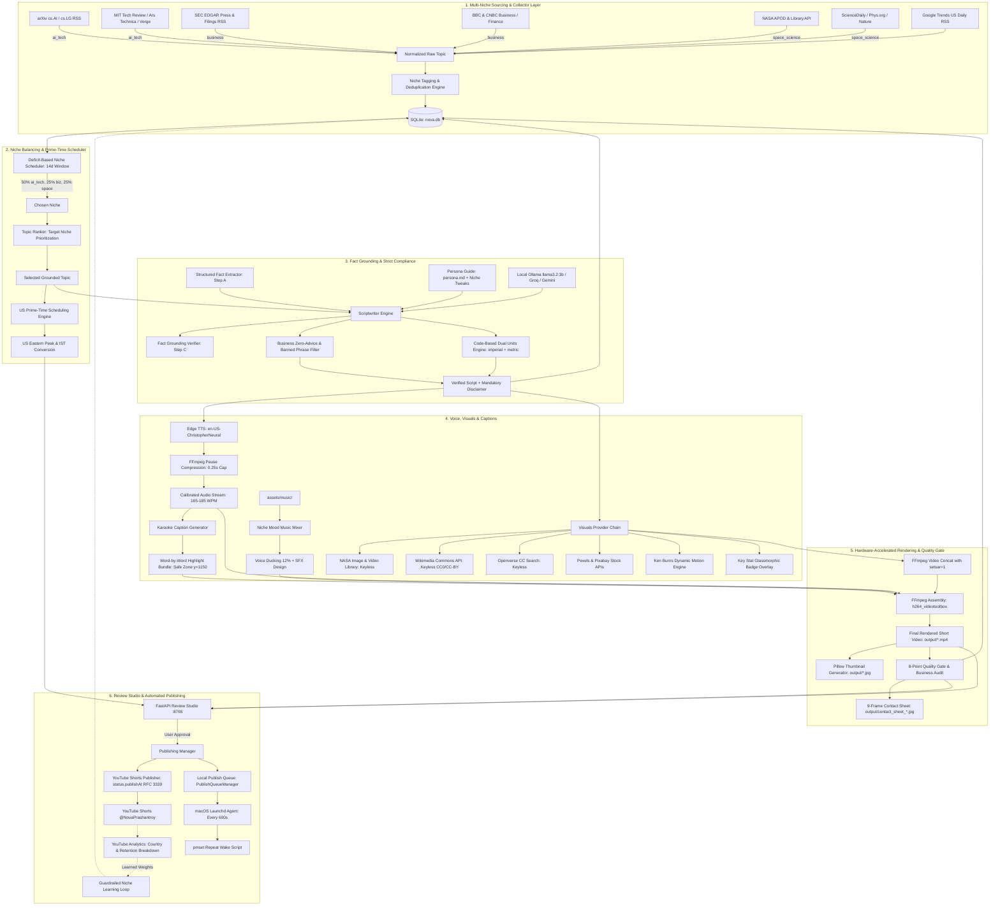

# Nova Autopilot v3.0: Architecture & System Design 📐

> Technical specification, component diagrams, database schema, and extensibility guides for Nova Autopilot v3.0.

---

## 1. High-Level Architecture Diagram



---

## 2. End-to-End Linear Execution Lifecycle

To guarantee that the **8 GB unified memory limit of the Apple M2** is strictly respected, stages execute sequentially with immediate resource deallocation:

### Stage 1: Multi-Niche Fact & News Discovery (`nova.collectors`)
- Multiple failure-isolated collectors fetch fresh candidate topics with distinct timeouts and retries:
  - `ArxivAICollector`: arXiv `cs.AI` and `cs.LG` recent abstracts.
  - `EDGARCollector`: US SEC press releases and corporate disclosures with custom `User-Agent`.
  - `BusinessNewsCollector`: BBC Business and CNBC Business & Finance RSS feeds.
  - `TechNewsCollector`: The Verge, Ars Technica, and MIT Technology Review feeds.
  - `NASACollector`: APOD and breaking NASA mission discoveries.
  - `ScienceNewsCollector`: ScienceDaily, Phys.org, Nature headlines.
  - `GoogleTrendsCollector`: Google Trends US daily trending queries.
  - `HackerNewsCollector`: Tech innovation velocity.
- Batch deduplication uses a pre-fetched set of SHA-256 hashes over normalized title tokens to prevent SQLite duplicate key errors.

### Stage 2: Deficit-Based Niche Balancing & Topic Selection (`nova.niches` & `nova.ranking`)
- Queries rolling 14-day history in `nova.db` and calculates actual posting share vs target weights:
  - 50% AI & Technology (`ai_tech`)
  - 25% Business & Economics (`business`)
  - 25% Space & Science (`space_science`)
- Selects the niche with the highest deficit.
- **Hard Constraint**: If the last two videos were in the same niche, that niche is strictly disqualified from consecutive selection.
- `TopicRanker` filters candidate topics specifically matching the chosen niche and scores surprise value.

### Stage 3: Fact-Grounded Script Generation & Compliance (`nova.scriptwriter`)
- **Step A (Research)**: Queries Wikipedia/NASA APIs for article extracts and compiles structured candidate facts (`StructuredFact`).
- **Step B (Generation)**: Injects niche-specific persona guidance and hook formulas:
  - `ai_tech`: Explains system mechanism + 1 real-world comparison. No buzzwords.
  - `business`: Explains economic mechanisms. Strict zero financial advice. All numbers must carry time context ("in 2023", "as of Q3 2025"). Mandatory disclaimer: *"For entertainment and education only. Not financial advice."*
  - `space_science`: Mind-blowing cosmic physics with code-based dual unit conversions.
- **Step C (Verification)**: Automatically scans output for hallucinations, verifies numbers against source facts, enforces <= 12 words hook, and checks for banned phrases.

### Stage 4: Voiceover & Pacing Calibration (`nova.tts`)
- Narrates using Edge-TTS with `en-US-ChristopherNeural` (energetic, authoritative documentary voice).
- Trims leading/trailing silence and caps pauses between sentences at 0.25 seconds using FFmpeg `silenceremove` filter.
- Calibrates speaking pace to 150–200 words per minute (re-synthesizes if out of bounds).

### Stage 5: Karaoke Subtitle Generation (`nova.captions`)
- Converts word timestamps into ASS dialogue lines and pre-renders transparent 1080x1920 PNG cards with word-by-word active highlight in vivid yellow (`#FFD700`).
- Positions text in the lower-middle safe zone (`y=1150`) to avoid YouTube Shorts and Instagram Reels UI overlays.

### Stage 6: Visual Asset Acquisition (`nova.visuals`)
- 6-tier fallback chain:
  1. Pexels portrait stock video
  2. Pixabay portrait stock video
  3. NASA Image & Video Library (Keyless, public domain)
  4. Wikimedia Commons API (Keyless, Creative Commons CC0/CC-BY)
  5. Openverse CC search (Keyless)
  6. Pexels/Pixabay photos with Ken Burns dynamic motion
- Last resort only: Designed typography cards (never flat color backgrounds).
- Automatically overlays glassmorphic Key Stat badges if a scene highlights a dramatic metric.

### Stage 7: Sound Design & Mixing (`nova.music`)
- Selects mood-matched royalty-free tracks from `assets/music/` based on niche preference:
  - `ai_tech`: `upbeat`
  - `business`: `mystery`
  - `space_science`: `epic`
- Automatically ducks background music to 12% volume during speech.
- Inserts synthesized whoosh and impact sound effects on scene transitions.

### Stage 8: Hardware-Accelerated Video Assembly (`nova.renderer`)
- Assembles scene clips using FFmpeg filter complex concat with `setsar=1` to guarantee 1:1 pixel aspect ratio and seamless PTS synchronization.
- Encodes output at 1080x1920 30fps using Apple Silicon `h264_videotoolbox` hardware acceleration.

### Stage 9: Thumbnail Generation (`nova.thumbnails`)
- Extracts a high-action frame and applies a high-contrast title banner and channel branding.

### Stage 10: Video Record Persistence & Prime-Time Scheduling (`nova.schedule_engine`)
- Computes next available slot in US Eastern prime time (`America/New_York`):
  - Lunch peak: 12:00 PM – 1:00 PM Eastern
  - Evening prime: 6:00 PM – 9:00 PM Eastern
- Automatically handles Daylight Saving Time (EDT vs EST) via `zoneinfo`.
- Converts to India Standard Time (`Asia/Kolkata`, +05:30) and stores in `Video` model.

### Stage 11: Quality Gate & Contact Sheet (`nova.quality`)
- Runs 8-point audit:
  1. Duration (20s–40s)
  2. Narration pace (150–200 WPM)
  3. Hook word count (<=12 words)
  4. Fact grounding citations
  5. Visual scene query diversity
  6. Flat frame spatial variance check (`spatial_std < 3.5` flagged as flat)
  7. Media license attribution completeness
  8. **Business Financial Advice & Banned Phrase Compliance**
- Extracts 9 equidistant frames across the video and saves an inspection contact sheet (`output/contact_sheet_<id>.jpg`).

### Stage 12: Dispatch & Local Publish Queue (`nova.publish_queue`)
- If `publish_mode: review` (default), marks video `pending_review` for Web UI inspection.
- Enqueues video for scheduled local dispatch in `PublishQueue`.
- For background dispatch, a macOS `launchd` plist checks for due items every 10 minutes and prevents sleep during upload via `caffeinate`.

---

## 3. Database Schema Reference (`data/nova.db`)

```sql
CREATE TABLE topics (
    id INTEGER PRIMARY KEY AUTOINCREMENT,
    dedupe_hash VARCHAR(64) UNIQUE NOT NULL,
    title VARCHAR(255) NOT NULL,
    summary TEXT,
    source_name VARCHAR(64) NOT NULL,
    source_url VARCHAR(512),
    region VARCHAR(16) DEFAULT 'US',
    niche VARCHAR(512) DEFAULT 'ai_tech', -- ai_tech, business, space_science
    raw_score FLOAT DEFAULT 0.0,
    final_score FLOAT DEFAULT 0.0,
    status VARCHAR(32) DEFAULT 'pending',
    created_at DATETIME,
    used_at DATETIME
);

CREATE TABLE scripts (
    id INTEGER PRIMARY KEY AUTOINCREMENT,
    topic_id INTEGER REFERENCES topics(id),
    title VARCHAR(255) NOT NULL,
    hook TEXT NOT NULL,
    hook_candidates_json TEXT,         -- 5 rubric candidates
    language VARCHAR(16) DEFAULT 'en',  -- 'en' or 'hinglish'
    niche VARCHAR(50) DEFAULT 'ai_tech',
    scenes_json TEXT NOT NULL,
    cta TEXT,
    hashtags VARCHAR(255),
    description TEXT,
    facts_used_json TEXT,
    model_used VARCHAR(64),
    status VARCHAR(32) DEFAULT 'draft',
    created_at DATETIME
);

CREATE TABLE videos (
    id INTEGER PRIMARY KEY AUTOINCREMENT,
    script_id INTEGER REFERENCES scripts(id),
    video_path VARCHAR(512) NOT NULL,
    thumbnail_path VARCHAR(512),
    subtitle_path VARCHAR(512),
    audio_path VARCHAR(512),
    contact_sheet_path VARCHAR(512),   -- Visual audit grid
    quality_flag VARCHAR(32) DEFAULT 'pending', -- 'passed', 'low_visuals', 'failed'
    quality_gate_json TEXT,            -- Full 10-point audit metrics
    subtitle_sync_stats_json TEXT,     -- faster-whisper forced alignment drift metrics
    visual_alignment_json TEXT,        -- Sentence-to-visual matches & relevance scores
    scheduled_time_utc DATETIME,       -- UTC timestamp for scheduling
    scheduled_time_us_eastern VARCHAR(50), -- e.g. 2026-11-13 06:00 PM EST
    scheduled_time_ist VARCHAR(50),        -- e.g. 2026-11-14 04:30 AM IST
    duration_seconds FLOAT,
    status VARCHAR(32) DEFAULT 'pending_review',
    created_at DATETIME,
    approved_at DATETIME
);

CREATE TABLE reference_videos (
    id INTEGER PRIMARY KEY AUTOINCREMENT,
    channel_id VARCHAR(100) NOT NULL,
    channel_title VARCHAR(200),
    video_id VARCHAR(100) UNIQUE NOT NULL,
    title VARCHAR(500) NOT NULL,
    published_at DATETIME,
    duration_seconds FLOAT,
    is_short BOOLEAN DEFAULT TRUE,
    view_count INTEGER DEFAULT 0,
    like_count INTEGER DEFAULT 0,
    comment_count INTEGER DEFAULT 0,
    tags_json TEXT,
    outlier_score FLOAT DEFAULT 1.0,
    niche VARCHAR(50) DEFAULT 'ai_tech',
    fetched_at DATETIME
);

CREATE TABLE study_notes (
    id INTEGER PRIMARY KEY AUTOINCREMENT,
    topic VARCHAR(500) NOT NULL,
    why_worked TEXT,
    hook_type VARCHAR(100),
    structure TEXT,
    weaknesses TEXT,
    what_to_do_differently TEXT,
    video_url VARCHAR(500),
    niche VARCHAR(50) DEFAULT 'ai_tech',
    created_at DATETIME
);

CREATE TABLE hook_patterns (
    id INTEGER PRIMARY KEY AUTOINCREMENT,
    pattern_type VARCHAR(100) NOT NULL,
    template_text TEXT NOT NULL,
    example_text TEXT,
    times_used INTEGER DEFAULT 0,
    avg_retention FLOAT DEFAULT 0.0,
    created_at DATETIME
);

CREATE TABLE structure_templates (
    id INTEGER PRIMARY KEY AUTOINCREMENT,
    name VARCHAR(100) NOT NULL,
    target_duration_seconds FLOAT DEFAULT 30.0,
    beats_json TEXT NOT NULL,
    times_used INTEGER DEFAULT 0,
    created_at DATETIME
);

CREATE TABLE title_formulas (
    id INTEGER PRIMARY KEY AUTOINCREMENT,
    formula_text TEXT NOT NULL,
    category VARCHAR(100) DEFAULT 'shock',
    times_used INTEGER DEFAULT 0,
    created_at DATETIME
);

CREATE TABLE publish_queue (
    id INTEGER PRIMARY KEY AUTOINCREMENT,
    video_id INTEGER REFERENCES videos(id),
    platform VARCHAR(50) NOT NULL,     -- youtube, instagram
    scheduled_time_utc DATETIME NOT NULL,
    scheduled_time_us_eastern VARCHAR(50),
    scheduled_time_ist VARCHAR(50),
    status VARCHAR(30) DEFAULT 'pending', -- pending, processing, completed, failed, missed
    attempts INTEGER DEFAULT 0,
    error_message TEXT,
    created_at DATETIME,
    published_at DATETIME
);

CREATE TABLE niche_weights_learned (
    id INTEGER PRIMARY KEY AUTOINCREMENT,
    niche VARCHAR(50) UNIQUE NOT NULL,
    weight FLOAT NOT NULL,
    updated_at DATETIME
);

CREATE TABLE publications (
    id INTEGER PRIMARY KEY AUTOINCREMENT,
    video_id INTEGER REFERENCES videos(id),
    platform VARCHAR(32) NOT NULL,
    platform_post_id VARCHAR(128) NOT NULL,
    platform_url VARCHAR(512),
    status VARCHAR(32) NOT NULL,
    views INTEGER DEFAULT 0,
    likes INTEGER DEFAULT 0,
    comments INTEGER DEFAULT 0,
    views_by_country_json TEXT,         -- JSON map of country views: {"US": 120, "GB": 45}
    avg_view_duration_seconds FLOAT,
    retention_rate FLOAT,
    published_at DATETIME
);
```
